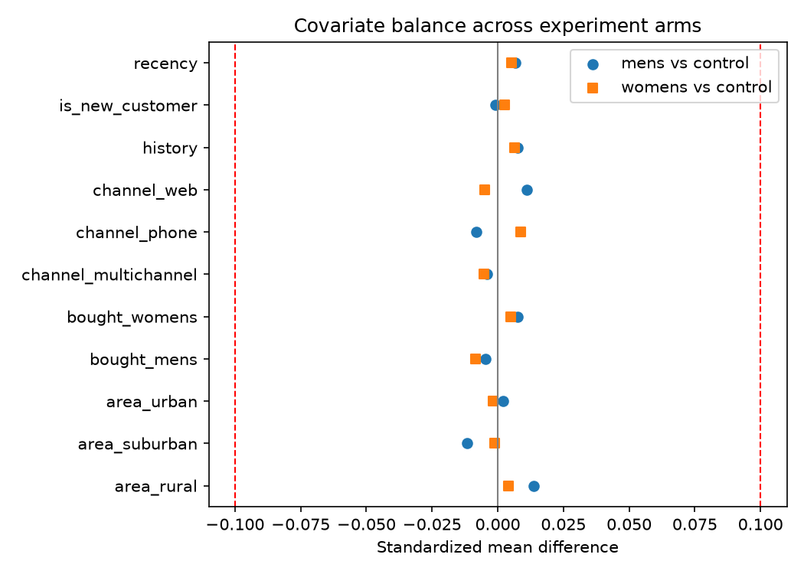
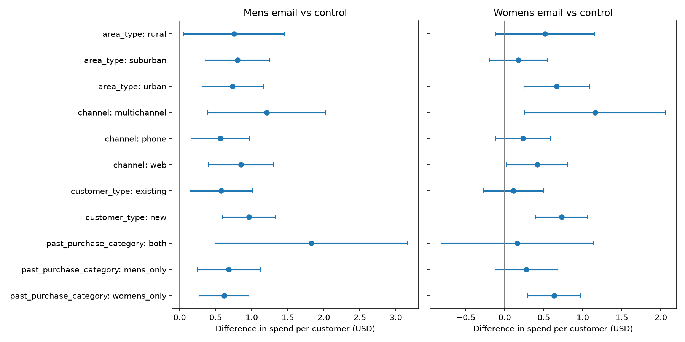

# Email Campaign A/B Test: Which Email Drives More Spend?

End-to-end analysis of a randomized email experiment with 64,000 customers, using **MySQL** for data
loading, validation and metric computation, and **Python** for statistical inference.

## TL;DR

- **Finding:** the mens email outperforms both the womens email and no email on visits, conversions and
  spend. Sending it to all customers adds an estimated **$49k in revenue over two weeks** (+118% spend per
  customer vs no email), about 1.8× the uplift of the womens email.
- **Method:** randomization checks (sample ratio mismatch, covariate balance) → effect estimates with
  confidence intervals → a direct head-to-head test of the two emails → Holm correction across all tests →
  subgroup analysis (Cochran's Q with FDR control) → policy evaluation and break-even analysis.
- **SQL:** bulk loading with reconciliation, rule-based data-quality checks, a cleaned view layer, CTEs,
  unpivoting with `UNION ALL`, self-joins, window functions, pivoting with conditional aggregation, and
  CUPED variance reduction computed entirely in SQL.

## Business question

An online retailer randomly assigned 64,000 customers who had purchased in the past 12 months to one of
three equally sized groups: an email featuring **men's** merchandise, an email featuring **women's**
merchandise, or **no email** (control). Visits, purchases and spend were tracked for two weeks.

1. Does each email increase visits, purchases and spend?
2. Which email performs better?
3. Should different customers receive different emails?

## Results

### Outcomes by group

| Group | Customers | Visit rate | Conversion rate | Spend per customer |
|---|---|---|---|---|
| No email (control) | 21,306 | 10.6% | 0.57% | $0.65 |
| Mens email | 21,307 | 18.3% | 1.25% | $1.42 |
| Womens email | 21,387 | 15.1% | 0.88% | $1.08 |

### Treatment effects

Differences with 95% confidence intervals. All 9 tests remain significant after Holm correction.
Spend per customer is the primary metric.

| Comparison | Visit rate | Conversion rate | Spend per customer |
|---|---|---|---|
| Mens vs control | +7.66 pp [7.00, 8.32] | +0.68 pp [0.50, 0.86] | +$0.77 [0.49, 1.05] |
| Womens vs control | +4.52 pp [3.89, 5.16] | +0.31 pp [0.15, 0.47] | +$0.42 [0.17, 0.68] |
| Mens vs womens | +3.14 pp [2.43, 3.84] | +0.37 pp [0.17, 0.56] | +$0.35 [0.03, 0.66] |

### Key findings

- **Both emails work, and the mens email works better** on every metric. The evidence on spend for mens vs
  womens is the weakest (Holm-adjusted p = 0.031) and would not survive a Bonferroni correction.
- **The mens email lifts spend in every customer segment**, including customers who previously bought only
  women's merchandise, with no significant heterogeneity across segments.
- **The womens email barely attracts customers who previously bought only men's merchandise**
  (+1.1 pp in visit rate, vs about +7 pp in other groups).
- **Targeting by past purchase category adds nothing measurable:** $457 over the mens-email-to-all policy,
  95% CI −$11,283 to $12,198.

### Recommendation

Send the mens email to all customers. At a 30% gross margin it is profitable whenever an email costs less
than **$0.23** (or **$0.15** at the lower bound of the confidence interval). Keep a random holdout group
(5–10%) in future campaigns to keep measuring incrementality, and test the womens email on new customers
as a follow-up hypothesis.

## Analysis design decisions

These choices determine whether the conclusions are valid, and they are the core of the analysis.

- **Check the randomization before looking at outcomes.** Arm sizes match the designed 1:1:1 split
  (χ² test, p = 0.90), and all 11 pre-experiment covariates are balanced (max |standardized mean
  difference| = 0.014). Balance is assessed with standardized mean differences rather than p-values,
  because with 21,000 customers per group even trivial differences become statistically significant.
- **Analyse at the level of randomization.** Every metric uses all customers in a group as the
  denominator, including those who spent nothing. This is an intent-to-treat analysis: it measures the
  effect of *sending* the email, which is the decision the business controls.
- **Treat average order value as descriptive only.** It is computed only over customers who purchased,
  and the email changes who purchases, so comparing it across groups is not a causal comparison.
- **Compare the two emails directly.** "Both emails beat control, and the mens email has the larger lift"
  does not show that the mens email is better. The difference between the two emails is tested head to head.
- **Correct for multiple comparisons, and choose the method by purpose.** The 9 confirmatory tests use
  Holm, which controls the family-wise error rate and is never more conservative than Bonferroni. The
  exploratory subgroup tests use Benjamini-Hochberg, which controls the false discovery rate.
- **Segment only by pre-experiment attributes.** Randomization then still holds within each segment.
  Heterogeneity is tested directly with Cochran's Q, because "significant in one segment but not in
  another" does not mean the effects differ.
- **Report a negative result honestly.** CUPED using past-year spend reduced variance by only 0.05%
  (correlation 0.02), because purchases are rare and no same-metric pre-period data is available.
  Unadjusted estimates are therefore reported.
- **Avoid the winner's curse in targeting.** Choosing the best email per segment and evaluating that choice
  on the same data overstates the gain. The extra value of targeting is reported with its uncertainty.

## SQL highlights

| Technique | File | Purpose |
|---|---|---|
| Typed schema design (`DECIMAL` for money, sized `VARCHAR`) | [`01_create_raw_table.sql`](sql/01_create_raw_table.sql) | Exact monetary arithmetic |
| `LOAD DATA LOCAL INFILE` with quoted fields | [`02_load_raw_data.sql`](sql/02_load_raw_data.sql) | Bulk load, handling commas inside values and Windows line endings |
| Reconciliation queries | [`03_validate_raw_load.sql`](sql/03_validate_raw_load.sql) | Verify the load against independently computed figures |
| Rule-based checks with `UNION ALL`, case-sensitive collation | [`04_data_quality_checks.sql`](sql/04_data_quality_checks.sql) | Data quality and business-logic validation |
| View as a cleaned analysis layer | [`05_create_clean_view.sql`](sql/05_create_clean_view.sql) | Fix and rename fields without modifying raw data |
| CTEs, unpivot, self-join | [`08_covariate_balance.sql`](sql/08_covariate_balance.sql) | Standardized mean differences for 11 covariates |
| `CROSS JOIN` to a baseline, `CAST` to avoid precision loss | [`09_metrics_by_arm.sql`](sql/09_metrics_by_arm.sql) | Absolute and relative lift vs control |
| Covariance from first principles | [`11_cuped_spend.sql`](sql/11_cuped_spend.sql) | CUPED variance reduction |
| Window function over an aggregate | [`12_segment_summary_stats.sql`](sql/12_segment_summary_stats.sql) | Segment shares within each arm |
| Pivot via conditional aggregation, `GREATEST` | [`13_policy_value.sql`](sql/13_policy_value.sql) | Value of alternative targeting policies |

SQL handles data preparation and aggregation; Python receives only summary statistics and performs the
statistical inference. Test functions in [`src/stats.py`](src/stats.py) are implemented from their formulas
and cross-checked against `scipy` and `statsmodels`.

## Figures

**Covariate balance across experiment groups**



**Effect on spend per customer by segment**



## Repository structure

```
email-campaign-ab-test/
├── sql/                    # All queries, numbered in execution order
├── src/
│   ├── db.py               # MySQL connection and helper to run .sql files
│   ├── download_data.py    # Reproducible download of the raw data
│   └── stats.py            # Hypothesis tests and heterogeneity test
├── notebooks/
│   ├── 01_data_profiling.ipynb
│   ├── 02_randomization_checks.ipynb
│   ├── 03_ab_analysis.ipynb
│   ├── 04_heterogeneous_effects.ipynb
│   └── 05_business_impact.ipynb
├── reports/figures/
├── .env.example            # Template for database credentials
└── requirements.txt
```

## How to reproduce

Requires Python 3.10+ and MySQL 8.0+.

1. Create the database and a dedicated user (as the MySQL root user):

   ```sql
   CREATE DATABASE hillstrom CHARACTER SET utf8mb4 COLLATE utf8mb4_0900_ai_ci;
   CREATE USER 'analyst'@'localhost' IDENTIFIED BY 'your_password_here';
   GRANT ALL PRIVILEGES ON hillstrom.* TO 'analyst'@'localhost';
   SET PERSIST local_infile = 1;
   ```

2. Set up the Python environment and credentials:

   ```bash
   python -m venv .venv
   source .venv/bin/activate        # Windows: .venv\Scripts\Activate.ps1
   pip install -r requirements.txt
   cp .env.example .env             # then fill in your password
   ```

3. Download the data and build the database (run from the project root):

   ```bash
   python -m src.download_data
   mysql -u analyst -p hillstrom -e "source sql/01_create_raw_table.sql"
   mysql --local-infile=1 -u analyst -p hillstrom -e "source sql/02_load_raw_data.sql"
   mysql -u analyst -p hillstrom -e "source sql/05_create_clean_view.sql"
   ```

   Scripts `03`, `04` and `06` are validation queries and can be run the same way.

4. Run the notebooks in numerical order.

## Limitations and next steps

- Spend is revenue, not profit, and outcomes cover only two weeks after the campaign.
- There is no data on email costs, unsubscribes or long-term effects on customer value.
- The data is from 2008; effects may differ for today's customers and email channels.
- The apparent extra effectiveness of the womens email for new customers did not survive FDR correction;
  it should be tested in a new experiment rather than acted on.

## Data source

Kevin Hillstrom, [MineThatData E-Mail Analytics and Data Mining Challenge](https://blog.minethatdata.com/2008/03/minethatdata-e-mail-analytics-and-data.html) (2008).
